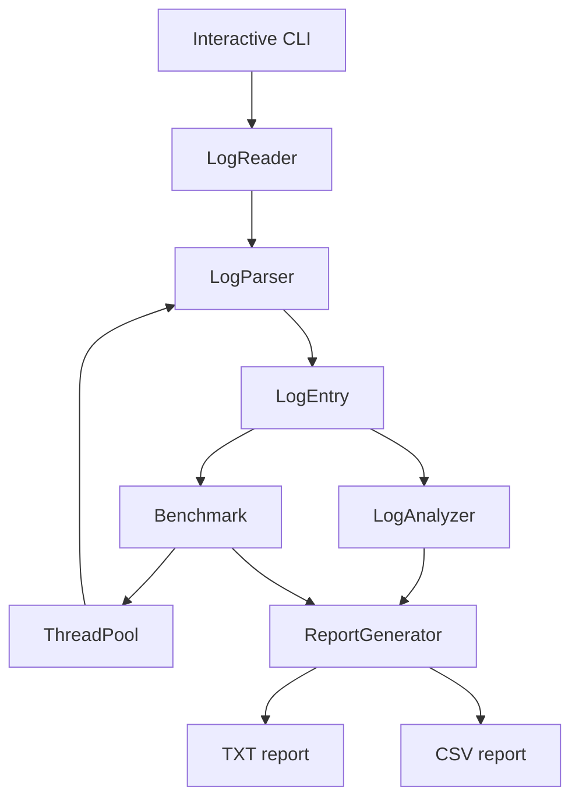

# LogPulse – High-Performance Multithreaded Log Analyzer

LogPulse is a C++17 command-line application for parsing, analyzing, filtering, benchmarking, and reporting on application log files. It includes both a sequential pipeline and a reusable multithreaded pipeline built with the C++ standard library.

## 1. Problem statement

Large log files contain valuable operational information, but manually inspecting them is slow and error-prone. LogPulse automates common observability tasks such as severity counting, keyword search, error-frequency analysis, filtering, and performance measurement.

## 2. Objectives

- Build a modular C++17 system using production-oriented design practices.
- Process logs incrementally instead of requiring an entire file in memory.
- Demonstrate safe multithreading with a reusable thread pool.
- Compare sequential and parallel processing using real measurements.
- Generate portable TXT and CSV reports suitable for further analysis.

## 3. Features

- Single-file and multi-file analysis.
- INFO, DEBUG, WARNING, ERROR, and CRITICAL levels.
- Invalid/corrupted line detection.
- Case-insensitive keyword search.
- Minimum-severity filtering.
- Timestamp-range filtering through the reusable analyzer API.
- Top recurring ERROR/CRITICAL messages.
- Sequential versus parallel benchmark.
- Configurable worker count.
- TXT and CSV report generation.
- Unit/integration tests through CTest.
- No third-party runtime dependencies.

## 4. Technology stack

| Technology | Use |
|---|---|
| C++17 | Application implementation |
| STL | Containers, algorithms, strings, futures, filesystem, I/O |
| `std::thread` | Worker threads |
| `std::mutex` | Thread-pool queue synchronization |
| `std::condition_variable` | Worker wake-up/blocking |
| `std::atomic` | Demonstrated in concurrency tests |
| CMake | Portable build configuration |
| GCC / MinGW | C++ compiler |
| Git / GitHub | Source control and portfolio hosting |
| VS Code | Recommended development environment |

## 5. Architecture



See [`docs/architecture.md`](docs/architecture.md) for component responsibilities and the concurrency/memory model.

## 6. Folder structure

```text
LogPulse/
├── CMakeLists.txt
├── README.md
├── .gitignore
├── include/
│   ├── LogEntry.h
│   ├── LogParser.h
│   ├── LogReader.h
│   ├── LogAnalyzer.h
│   ├── ThreadPool.h
│   ├── ReportGenerator.h
│   └── Benchmark.h
├── src/
│   ├── main.cpp
│   ├── LogParser.cpp
│   ├── LogReader.cpp
│   ├── LogAnalyzer.cpp
│   ├── ThreadPool.cpp
│   ├── ReportGenerator.cpp
│   └── Benchmark.cpp
├── data/
│   ├── sample.log
│   └── sample2.log
├── reports/
├── tests/
│   ├── test_parser.cpp
│   ├── test_analyzer.cpp
│   ├── test_threadpool.cpp
│   └── test_integration.cpp
└── docs/
    └── architecture.md
```

## 7. Log format

```text
YYYY-MM-DD HH:MM:SS [LEVEL] message
```

Example:

```text
2026-11-18 09:00:04 [ERROR] Database connection timeout
```

Malformed lines are counted as invalid rather than crashing the application.

## 8. How it works

1. `LogReader` opens a file with RAII-managed `std::ifstream`.
2. `LogParser` validates the timestamp and severity marker and creates a `LogEntry`.
3. `LogAnalyzer` computes counts and recurring error messages using STL containers and algorithms.
4. Search/filter APIs operate over parsed entries.
5. `Benchmark` runs equivalent sequential and bounded-chunk parallel processing.
6. `ThreadPool` coordinates worker threads through a protected task queue and condition variable.
7. `ReportGenerator` exports metrics to TXT and CSV.

## 9. Prerequisites

- C++17 compiler: GCC 9+ or a recent MinGW-w64 toolchain.
- CMake 3.16+.
- VS Code is optional.

### Windows / MinGW

Open **PowerShell** or the VS Code terminal after installing MinGW-w64 and CMake. Ensure `g++` and `cmake` are on `PATH`.

## 10. Build

From the project root:

```powershell
cmake -S . -B build -G "MinGW Makefiles"
cmake --build build --config Release
```

If your generator is already configured, simply use:

```powershell
cmake --build build --config Release
```

On Linux/macOS:

```bash
cmake -S . -B build
cmake --build build -j
```

## 11. Run

Windows MinGW:

```powershell
.\build\LogPulse.exe
```

Linux/macOS:

```bash
./build/LogPulse
```

Then choose an operation. For example, enter `data/sample.log` for a single-file analysis.

## 12. Testing

Build the tests with the normal CMake build, then run:

```bash
ctest --test-dir build --output-on-failure
```

The suite covers parsing, statistics/search/filter behavior, thread-pool execution, large-ish generated test input, benchmark result parity, and report creation.

## 13. Benchmark methodology

LogPulse never fabricates timing numbers. The benchmark uses `std::chrono::steady_clock` around the actual sequential and parallel pipelines. The parallel implementation uses a reusable worker pool and bounded 10,000-line tasks. Before reporting timings, the application checks that both paths processed the same number of lines and valid entries.

For meaningful comparisons, run the benchmark on a sufficiently large dataset and repeat it several times. Small files can be slower in parallel because thread creation, scheduling, synchronization, and task management have overhead.

Reported metrics include:

- Sequential elapsed milliseconds.
- Parallel elapsed milliseconds.
- Worker count.
- Entries processed.
- Entries/second for both paths.
- Calculated speedup (`sequential / parallel`).

## 14. Sample output

A typical analysis of `data/sample.log` will show the total number of input lines, valid/invalid records, counts for all five severities, and the most frequent ERROR/CRITICAL messages. Exact benchmark times depend on the machine and dataset and are intentionally measured at runtime.


Suggested resume bullets:

- **LogPulse – High-Performance Multithreaded Log Analyzer:** Built a modular C++17 log-processing engine using streaming file I/O, STL algorithms, RAII, and a reusable `std::thread`-based thread pool.
- Implemented concurrent chunk processing with mutex/condition-variable synchronization, invalid-entry handling, severity/keyword analysis, and real `chrono`-based sequential vs. parallel benchmarking with TXT/CSV reports.
