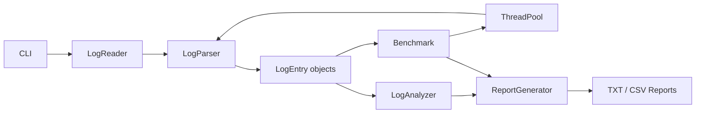

# LogPulse Architecture

## High-level flow

## Responsibilities

- **LogEntry**: domain model for a parsed log record and severity enumeration.
- **LogParser**: validates and parses one line without owning external resources.
- **LogReader**: streams files line-by-line for normal analysis and combines multiple files.
- **LogAnalyzer**: computes statistics, searches, severity filters, timestamp filters, and top errors.
- **ThreadPool**: reusable worker abstraction backed by `std::thread`, `std::mutex`, `std::condition_variable`, and futures.
- **Benchmark**: executes equivalent sequential and chunked parallel pipelines and verifies result parity before reporting timings.
- **ReportGenerator**: serializes analysis and benchmark metrics to human-readable TXT and CSV.
- **CLI**: validates input and coordinates the components; it does not contain parsing or analysis logic.

## Concurrency model

Parallel processing reads bounded chunks of 10,000 lines and submits each chunk as an independent task. Each task owns its local `ReadResult`, so counters and vectors do not require shared mutable state. Results are merged by the calling thread after futures complete. This avoids data races on analysis state and keeps synchronization localized to the thread-pool queue.

## Memory strategy

Normal analysis streams a file line-by-line. Parallel analysis holds only bounded chunks while work is queued, rather than materializing a complete multi-gigabyte file. `std::unique_ptr` is used for application-owned analyzer state; `std::shared_ptr` is used internally by `ThreadPool` to safely extend a packaged task's lifetime until a worker executes it. RAII owns files, threads, futures, and containers.

## Error handling

I/O failures and invalid user input are reported as exceptions/errors. Malformed log lines are counted as invalid entries rather than terminating a complete analysis. Benchmark execution aborts if sequential and parallel results do not agree.
